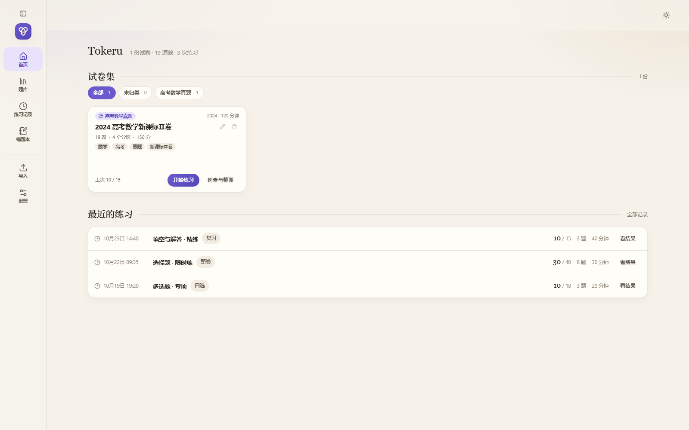
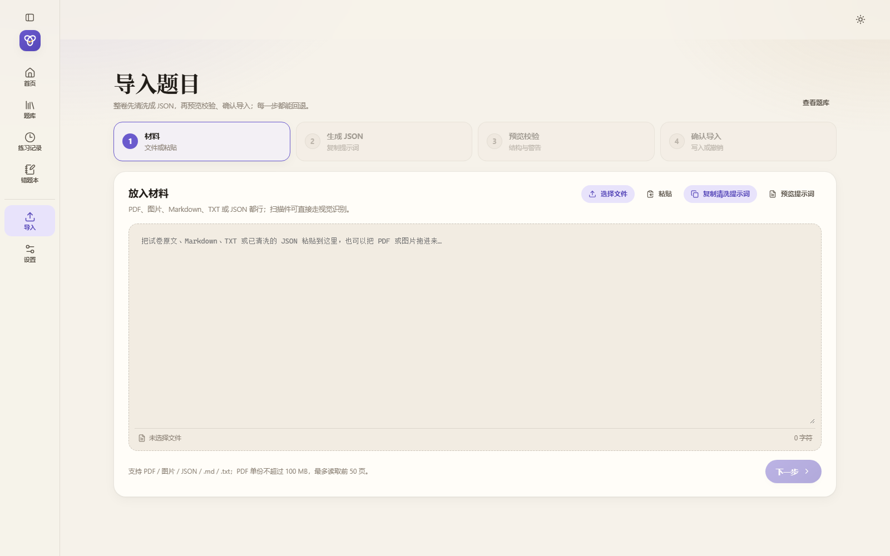
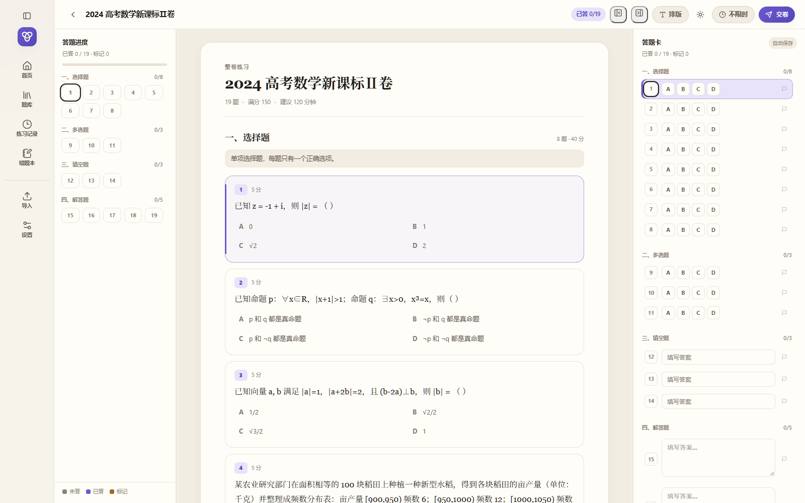

<p align="center">
  
</p>

<h1 align="center">Tokeru</h1>

<p align="center">与AI协作，把任意试卷、讲义或题库变成可练的题目，同时保留原卷的阅读体验。</p>

<p align="center">
  <a href="https://github.com/Cleverrobot996/Tokeru/releases"></a>
  <a href="https://github.com/Cleverrobot996/Tokeru/blob/main/LICENSE"></a>
  <a href="https://github.com/Cleverrobot996/Tokeru/actions/workflows/ci.yml"></a>
  
</p>




| 导入材料 | 考试工作台 |
| --- | --- |
|  |  |

## 下载

从 [Releases](https://github.com/Cleverrobot996/Tokeru/releases) 下载：

- `Tokeru_0.0.1_x64-setup.exe`
- 安装到 `%LOCALAPPDATA%\Tokeru\app-版本号`，不需要管理员权限，不会覆盖已有题库。
- 安装包未签名；SmartScreen 提示时点「更多信息 → 仍要运行」。

## 功能

- **导入任意材料**：PDF、图片、Markdown、TXT、JSON 都可以拖进「导入」，也可以直接粘贴按导入规范写的文字。PDF 单文件上限 100 MB、最多读取 50 页；扫描件可走视觉 OCR。
- **原卷优先**：详细模式按试卷原样排版，材料题只出现一次共享材料，题干支持 `{{blank:31}}` 行内空位；完形、听写、阅读这类题不会被拆成一张张孤立的答题卡。排版可切换高对比、字号、行高、段距、纸宽与字体。
- **题库与标签**：固定「学科 / 题型 / 难度」三栏，可增加自定义标签栏；同栏多选是 OR，不同栏之间是 AND。标签可拖放归类、删除；试卷与题目都能打标签。
- **练习与判分**：整卷、自选、错题复习、限时练习；客观题本地判分，主观题可自评或让 AI 判卷并写评语。没有分值的练习可以自定义总分，让 AI 重新分配每题分值。
- **记录与错题**：练习记录按日期归档，可多选写进错题本；错题本支持待复习 / 已掌握 / 全部，也能直接组一套复习练习。
- **AI 可选**：AI 解释、写作自评、导入清洗、视觉 OCR、自动分图、AI 判卷都走 OpenAI 兼容接口；默认关闭，Key 只存本机。
- **MCP 连接**：桌面版内置只监听 `127.0.0.1` 的 MCP Server（Streamable HTTP，默认 17890 端口，19 个工具）。外部 Agent 可以读题库、校验导入、写入试卷；默认关闭、默认只读。详见 [docs/MCP.md](docs/MCP.md)。
- **本地数据**：SQLite 单文件，支持立即备份与恢复；换机器时复制数据目录即可。

## 快速开始

### 从源码运行

需要 Windows 10/11、WebView2 Runtime、Node.js 22+、pnpm 10+、Rust stable，以及带 C++ 桌面开发负载的 Visual Studio Build Tools。

```powershell
pnpm install
pnpm tauri dev
```

只做前端界面预览：

```powershell
pnpm dev
# http://127.0.0.1:1420
```

浏览器预览使用 `src/lib/mock.ts` 的演示数据，不写 SQLite；桌面版才连接真实数据库。

### 构建

```powershell
pnpm exec tsc --noEmit
pnpm test
cargo test --manifest-path src-tauri/Cargo.toml

pnpm tauri build --no-bundle        # 便携版 exe
pnpm tauri build --bundles nsis     # NSIS 安装包
```

产物：

- `src-tauri/target/release/tokeru.exe`
- `src-tauri/target/release/bundle/nsis/Tokeru_0.0.1_x64-setup.exe`

安装器使用独立版本目录 `%LOCALAPPDATA%\Tokeru\app-版本号`，不会覆盖正在运行的旧 exe；快捷方式会在安装后重定向到新版本。应用本身不要求管理员权限。

### 导入第一份材料

1. 打开「导入」，把 PDF / Markdown / TXT / JSON 拖进材料框，或直接粘贴原文。
2. 若材料不是规范 JSON，点「复制清洗提示词」交给任意 AI，或使用应用内 AI 清洗。
3. 在「预览校验」里检查结构、警告、题型分布和原卷预览，确认后写入题库。
4. 想先跑通流程，可导入 [data/seed/math_2024.json](data/seed/math_2024.json)：2024 高考数学新课标Ⅱ卷，19 题。

导入格式说明见 [shared/import-spec.md](shared/import-spec.md)。

## 数据与 AI

数据默认位置：

```text
%APPDATA%\com.tokero.app\tokero.db
%APPDATA%\com.tokero.app\media\
%APPDATA%\com.tokero.app\backups\
```

开发或自动化测试可用环境变量 `TOKERU_DATA_DIR` 指向独立目录：

```powershell
$env:TOKERU_DATA_DIR = "$PWD\.smoke-run"
.\src-tauri\target\release\tokeru.exe
```

AI 默认「不用 AI」。在「设置 → AI 解释」里选择 OpenAI / DeepSeek / 硅基流动 / 本地 Ollama / 自定义，填写 API Key 与地址即可。地址填到 `/v1` 为止，不要带 `/chat/completions`。自动分图、视觉 OCR 需要另填支持 `image_url` 的多模态模型。测试连接会直接使用当前填写的地址、模型与 Key，不必先保存；Key 只写入本机 SQLite，不回显、不上传。

## MCP

设置页打开「MCP 连接」后，外部 Agent 可按下面的形式连接：

```text
http://127.0.0.1:17890/mcp
Authorization: Bearer tk_...
```

默认只读；导入、改题、改名等写操作需要在设置页显式关闭只读。工具列表、客户端配置、鉴权与排错见 [docs/MCP.md](docs/MCP.md)。

## 项目结构

```text
src/                    React 前端
  pages/                首页、题库、考试、速查、记录、错题、导入、设置
  components/           Shell、排版、弹窗、图表等
  lib/                  API 封装、类型、mock、导入提示词、富文本消毒
  styles/               设计令牌与页面样式
src-tauri/src/          Rust 后端
  commands.rs           Tauri 命令
  repo.rs / db.rs       SQLite 读写与迁移
  models.rs             数据模型
  ai.rs                 OpenAI 兼容 AI 调用
  mcp.rs                内嵌 MCP Server
src-tauri/nsis/         安装器钩子
shared/import-spec.md   导入规范
data/seed/              可选导入样例（不随应用内置）
docs/                   使用与开发文档；archive/ 为历史记录
branding/               图标与品牌设计稿
```

更细的模块、命令与数据流见 [docs/SOURCE-MAP.md](docs/SOURCE-MAP.md)。

## 文档

| 文档 | 内容 |
| --- | --- |
| [docs/README.md](docs/README.md) | 文档索引：使用、开发与历史记录 |
| [AGENTS.md](AGENTS.md) | 给协作 Agent 的入口、源码地图与验证命令 |
| [docs/SOURCE-MAP.md](docs/SOURCE-MAP.md) | 模块、命令、数据流与历史增量 |
| [docs/MCP.md](docs/MCP.md) | MCP 工具、鉴权与客户端配置 |
| [shared/import-spec.md](shared/import-spec.md) | 导入 JSON / Markdown 规范 |
| [CONTRIBUTING.md](CONTRIBUTING.md) | 开发、提交与 PR 约定 |
| [CHANGELOG.md](CHANGELOG.md) | 版本变更记录 |
| [docs/archive/README.md](docs/archive/README.md) | 3.1–4.0 内部构建记录（仅追溯） |


## 许可证

**AGPL-3.0**
分发或衍生请保留 [LICENSE](LICENSE) 与 [NOTICE](NOTICE)，并注明来源：

> Tokeru — https://github.com/Cleverrobot996/Tokeru

Copyright 2026 Cleverrobot996.
